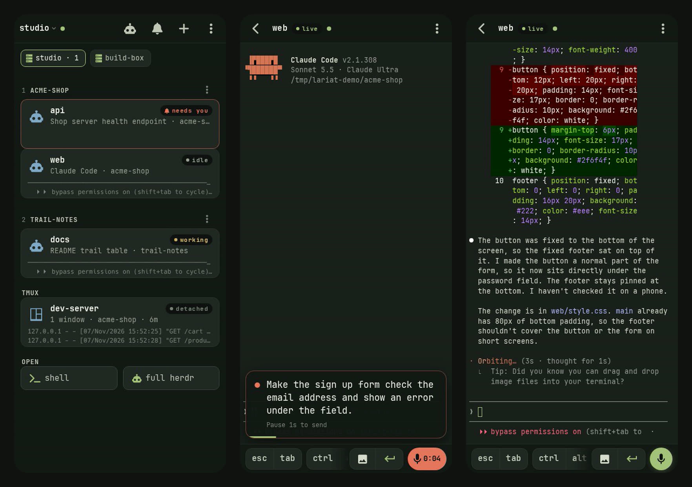

# lariat

**Your coding agents, on your phone.** A passkey-gated terminal and agent
dashboard for your own machine, served only on your Tailscale network and
installed on your phone's home screen.



- **See every agent at a glance**: which [herdr](https://herdr.dev) agent is
  working, done or needs you, with its last lines of output, plus your tmux
  sessions.
- **Jump in**: a full-screen terminal attached to the agent, tmux session or a
  shell, with a key bar made for thumbs (Esc, Tab, sticky Ctrl/Alt, arrows,
  Enter, paste).
- **Just say it**: tap the mic and talk. whisper.cpp transcribes on your own
  machine while you speak; pause, and it types the text and presses Enter.
- **Show it**: send a photo or screenshot from the phone into a session (the
  image key in the key bar, or paste); the agent gets the image.
- **Know when they finish**: push notifications to your lock screen when an
  agent needs you or is done, even with the app closed; tap one to open that
  agent. herdr agents report on their own; any other agent (Claude Code
  hooks, scripts) with `lariat notify`. No Apple Developer account and no
  third-party notification app.
- **All your machines**: run it on each and add them from the phone (one
  short command per machine), and the phone keeps one app: a chip per machine on the dashboard, every
  machine's alerts in one place, and every machine's updates (they install
  themselves from the releases, or tap Update).
- **Yours**: it runs as your user on your machine (Linux, macOS or Windows).
  Passkey login (Face ID), one-time QR enrollment, reachable only on your
  tailnet. No accounts, no telemetry, no CDN.

## Get started

You need [Tailscale](https://tailscale.com/download) on the machine and on
your phone, signed in to the same tailnet. Then, on the machine:

```sh
curl -fsSL https://raw.githubusercontent.com/marshallsfolly/lariat/main/install.sh | sh     # Linux, macOS
```

```powershell
irm https://raw.githubusercontent.com/marshallsfolly/lariat/main/install.ps1 | iex          # Windows (PowerShell)
```

The installer downloads the release binary for your machine, checks it
against the release's checksums, puts `lariat` on your PATH and starts
**`lariat setup`**, which walks you through the rest in a few minutes:

1. **HTTPS**: Tailscale's certificate (one switch in the admin console) or
   lariat's own CA (nothing public; the phone installs one certificate).
2. **Always on**: the background service.
3. **Your phone**: scan the QR code, tap **Create passkey**, then **Share →
   Add to Home Screen**, open the app and **Unlock**. Then **⋮ → Push
   notifications → Send a test**.
4. **Agent alerts**: Claude Code and Grok Build sessions tell your phone when
   they finish or need you.

**More machines**: run the installer on each and answer yes when setup asks
whether your phone already uses lariat; it takes the command the phone shows
under **tap the machine name → Add a machine**
([several machines](docs/machines.md)).

**NixOS or home-manager**: the module, [docs/nixos.md](docs/nixos.md). **By
hand**, or to see what each step does: [docs/setup.md](docs/setup.md).

Runs on Linux (x86_64, arm64), macOS (Apple Silicon, Intel) and Windows
(x86_64; terminals are PowerShell, no tmux or herdr). The phone needs
passkeys, and for push iOS 16.4+ with the app on the Home Screen. The agent
dashboard uses [herdr](https://herdr.dev); shells and tmux work without it.

## Let your agent set it up

Point your coding agent at this repository:

> Set up lariat on this machine so I can use it from my phone. Follow
> https://github.com/marshallsfolly/lariat/blob/main/AGENTS.md

[AGENTS.md](AGENTS.md) tells it what to check (`lariat doctor --json`), what
to ask you (HTTPS mode, background service, hooks), what only you can do (scan,
Face ID, Add to Home Screen) and what never to do (expose it beyond your
tailnet, run it as root).

## Documentation

- [Getting started](docs/setup.md): Tailscale, install, HTTPS, enrolling,
  running it as a service, notifications, dictation, updating, uninstalling.
- [HTTPS and certificates](docs/tls.md): Tailscale's certificate or your own
  CA, installing the CA on iPhone and Android, renewing, NixOS with nginx and
  sops-nix.
- [NixOS and home-manager](docs/nixos.md): the modules, herdr, GPU dictation,
  Claude Code hooks, passkeys from your secrets manager.
- [Several machines](docs/machines.md): one app on the phone for all of them.
- [Troubleshooting](docs/troubleshooting.md)
- [Security model](SECURITY.md)

## Works with

- **[herdr](https://herdr.dev)** for the agent dashboard: any agent herdr
  tracks (Claude Code, Codex, ...). Its status changes drive the badges and
  push notifications. Without herdr you get tmux sessions and shells.
- **tmux**: list, attach, create in a project directory, rename, kill.
- **Plain shells**: your login shell.
- **Any agent's hooks**: `lariat notify --hook claude stop` (and
  `notification`) from Claude Code hooks; `services.lariat.notify.claudeCode`
  sets them up on NixOS ([setup guide](docs/setup.md#7-agent-alerts)).
- **ntfy** (optional): an inbox fed by a topic on the same machine, also
  forwarded as push notifications.

## Security and privacy

lariat gives whoever unlocks it **a shell as your user**: it is built for one
owner on a private network. It listens only on your tailnet (`tailscale
serve`, never `funnel`), unlocks with a passkey, and has no accounts, telemetry
or CDN. What leaves the machine: push notifications (end-to-end encrypted,
through your phone's push service), update checks against GitHub from release
binaries (⋮ → Updates → Off), and, with Tailscale's certificate, the machine's
name in public Certificate Transparency logs (lariat's own CA avoids that).
Details: [SECURITY.md](SECURITY.md).

## Configuration

The NixOS module's options: [docs/nixos.md](docs/nixos.md#all-options).

### The `lariat` command

| Command | |
|---|---|
| `lariat setup` | Start here: Tailscale, HTTPS, the service, the phone and agent alerts, step by step (`--yes`: no questions). |
| `lariat` / `lariat serve` | Run it. `--host` (default: the MagicDNS name), `--port`, `--https-port`, `--name`, `--state`, `--no-tailscale-serve`, `--tailscale-cert`. |
| `lariat enroll [--new]` | QR code to enroll a device (one-time). |
| `lariat tls init [--renew]` / `tls phone` | Your own CA and certificate; serve the CA for the phone. |
| `lariat service install` / `uninstall` | Background service (systemd, launchd, Windows Startup). `--dry-run`; serve options after `--`. |
| `lariat hooks claude\|grok [--install]` | Agent hooks that report to lariat. |
| `lariat notify [--kind done\|blocked\|info] [--agent A] [--project P] TEXT` | Send an alert (`--hook AGENT EVENT` reads a hook's JSON on stdin). |
| `lariat doctor [--json]` | Check everything; print fixes. |
| `lariat join HUB CODE` | Add this machine to your hub, with the code from the phone (tap the name → Add a machine). |
| `lariat link [--name N] [--ca FILE]` / `--list` / `--revoke N` | Let a hub reach this machine without the phone ([several machines](docs/machines.md)). |
| `lariat machines add CODE [--name N]` / `list` / `remove N` | On the hub: the machines the phone reaches through it. |
| `lariat update [--check]` / `--mode auto\|notify\|off` | Update a release binary now, check, or choose automatic updates ([details](docs/setup.md#day-to-day)). |

`LARIAT_*` environment variables ([config.py](gateway/lariat/config.py)) set
the rest, e.g. `LARIAT_DICTATE_SERVER` and `LARIAT_DICTATE_MODEL`.

## Troubleshooting

`lariat doctor` first; then [docs/troubleshooting.md](docs/troubleshooting.md).

## Development

```sh
nix develop
cd gateway && python -m unittest discover -s tests -t . -v
nix build .#gateway .#web .#lariat   # the gateway's tests run here too
```

Layout: `gateway/` (Python: auth, sessions, providers, PTY bridge, dictation,
push, the `lariat` command), `web/` (vanilla ES modules, one stylesheet, the
bundle builder), `nix/` (packages, theme, NixOS and home-manager modules),
`examples/`.

## License and credits

MIT. Bundled at build time: xterm.js and addons (MIT), JetBrains Mono and the
Nerd Fonts symbols (OFL-1.1 / MIT).
